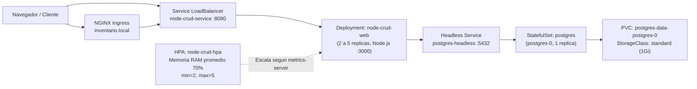

# Examen Final de Sistemas Distribuidos — Aplicacion Web Cloud-Native en Kubernetes (Minikube)

Solucion completa CRUD de **Gestion de Productos e Inventario** construida con **Node.js (Express)** y **PostgreSQL**, desplegada en **Minikube** con almacenamiento persistente (`StatefulSet` + `PVC`), enrutamiento (`LoadBalancer` + `Ingress`) y autoescalado horizontal basado exclusivamente en **memoria RAM (`HPA` al 70%)**.

---

## Arquitectura de la Solucion



### Decisiones Clave de Diseno

| Componente | Objeto Kubernetes | Configuracion Clave |
|---|---|---|
| Backend + UI CRUD | `Deployment` (`node-crud-web`) | 2 replicas iniciales, `requests.memory: 128Mi`, `limits.memory: 256Mi`, probes `/healthz` y `/readyz`, reconexion automatica a PostgreSQL. |
| Exposicion directa | `Service` (`node-crud-service`) | Tipo `LoadBalancer`, puerto `8080` hacia `3000` (separado del puerto `80` que usa el Ingress, para que `minikube tunnel` no choque). |
| Enrutamiento HTTP | `Ingress` (`node-crud-ingress`) | `ingressClassName: nginx`, host `inventario.local` hacia `node-crud-service:8080`. |
| Autoescalado | `HorizontalPodAutoscaler` (`node-crud-hpa`) | `autoscaling/v2`, `minReplicas: 2`, `maxReplicas: 5`, metrica `memory` (`averageUtilization: 70`). Sin metrica de CPU. |
| Base de datos | `StatefulSet` (`postgres`) | 1 replica (`postgres:16-alpine`), `PGDATA=/var/lib/postgresql/data/pgdata`, `volumeClaimTemplates` con StorageClass `standard` (`1Gi`). |
| Red interna DB | `Service` (`postgres-headless`) | `clusterIP: None`, puerto `5432`. |
| Credenciales | `Secret` (`postgres-secret`) | Inyectado como variables de entorno tanto en PostgreSQL como en Node.js. |
| Configuracion | `ConfigMap` (`node-crud-config`) | Parametros no sensibles de la app (`PORT`, `DB_HOST`, `DB_PORT`, `MAX_STRESS_MB`, `MAX_RSS_GUARD_MB`) inyectados con `envFrom`. |

---

## Estructura del Repositorio

```text
.
├── app/
│   ├── public/
│   │   ├── index.html          # UI responsiva en Bootstrap 5 + <dialog> nativos
│   │   └── app.js              # Logica cliente Fetch API (GET, POST, PUT, DELETE)
│   ├── package.json            # Dependencias (express, pg, dotenv)
│   ├── server.js               # API REST, reconexion resiliente, /healthz, /readyz, /stress-memory
│   ├── Dockerfile              # Imagen productiva basada en node:20-alpine
│   └── .dockerignore
├── k8s/
│   ├── 01-db-secret.yaml       # Credenciales de PostgreSQL
│   ├── 02-db-statefulset.yaml  # StatefulSet + volumeClaimTemplates (standard)
│   ├── 03-db-service.yaml      # Headless Service para comunicacion interna
│   ├── 04-web-configmap.yaml   # ConfigMap con la configuracion no sensible de la app
│   ├── 05-web-deployment.yaml  # Deployment Node.js (2 replicas, requests/limits)
│   ├── 06-web-service.yaml     # Service LoadBalancer en puerto 8080
│   ├── 07-web-hpa.yaml         # HPA por consumo de memoria al 70% (2 a 5 replicas)
│   └── 08-ingress.yaml         # Ingress NGINX (inventario.local)
├── scripts/
│   ├── deploy.sh               # Automatizacion completa de despliegue en Minikube
│   └── memory_stress.sh        # Script de carga controlada sobre /stress-memory
├── .gitignore
└── README.md
```

---

## Requisitos Previos (Ubuntu / Linux)

- Docker instalado y en ejecucion.
- `minikube` y `kubectl` instalados.
- `curl` disponible en la terminal.
