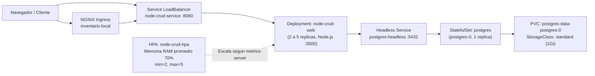

# Examen Final de Sistemas Distribuidos — Aplicacion Web Cloud-Native en Kubernetes (Minikube)

Solucion completa CRUD de **Gestion de Productos e Inventario** construida con **Node.js (Express)** y **PostgreSQL**, desplegada en **Minikube** con almacenamiento persistente (`StatefulSet` + `PVC`), enrutamiento (`LoadBalancer` + `Ingress`) y autoescalado horizontal basado exclusivamente en **memoria RAM (`HPA` al 70%)**.

---

## Arquitectura de la Solucion



### Decisiones Clave de Diseno

| Componente | Objeto Kubernetes | Configuracion Clave |
|---|---|---|
| Backend + UI CRUD | `Deployment` (`node-crud-web`) | 2 replicas iniciales, `requests.memory: 128Mi`, `limits.memory: 256Mi`, probes `/healthz` y `/readyz`, reconexion automatica a PostgreSQL. |
| Exposicion directa | `Service` (`node-crud-service`) | Tipo `LoadBalancer`, puerto `8080` hacia `3000` (separado del puerto `80` que usa el Ingress, para que `minikube tunnel` no choque). |
| Enrutamiento HTTP | `Ingress` (`node-crud-ingress`) | `ingressClassName: nginx`, host `inventario.local` hacia `node-crud-service:8080`. |
| Autoescalado | `HorizontalPodAutoscaler` (`node-crud-hpa`) | `autoscaling/v2`, `minReplicas: 2`, `maxReplicas: 5`, metrica `memory` (`averageUtilization: 70`). Sin metrica de CPU. |
| Base de datos | `StatefulSet` (`postgres`) | 1 replica (`postgres:16-alpine`), `PGDATA=/var/lib/postgresql/data/pgdata`, `volumeClaimTemplates` con StorageClass `standard` (`1Gi`). |
| Red interna DB | `Service` (`postgres-headless`) | `clusterIP: None`, puerto `5432`. |
| Credenciales | `Secret` (`postgres-secret`) | Inyectado como variables de entorno tanto en PostgreSQL como en Node.js. |
| Configuracion | `ConfigMap` (`node-crud-config`) | Parametros no sensibles de la app (`PORT`, `DB_HOST`, `DB_PORT`, `MAX_STRESS_MB`, `MAX_RSS_GUARD_MB`) inyectados con `envFrom`. |

---

## Estructura del Repositorio

```text
.
├── app/
│   ├── public/
│   │   ├── index.html          # UI responsiva en Bootstrap 5 + <dialog> nativos
│   │   └── app.js              # Logica cliente Fetch API (GET, POST, PUT, DELETE)
│   ├── package.json            # Dependencias (express, pg, dotenv)
│   ├── server.js               # API REST, reconexion resiliente, /healthz, /readyz, /stress-memory
│   ├── Dockerfile              # Imagen productiva basada en node:20-alpine
│   └── .dockerignore
├── k8s/
│   ├── 01-db-secret.yaml       # Credenciales de PostgreSQL
│   ├── 02-db-statefulset.yaml  # StatefulSet + volumeClaimTemplates (standard)
│   ├── 03-db-service.yaml      # Headless Service para comunicacion interna
│   ├── 04-web-configmap.yaml   # ConfigMap con la configuracion no sensible de la app
│   ├── 05-web-deployment.yaml  # Deployment Node.js (2 replicas, requests/limits)
│   ├── 06-web-service.yaml     # Service LoadBalancer en puerto 8080
│   ├── 07-web-hpa.yaml         # HPA por consumo de memoria al 70% (2 a 5 replicas)
│   └── 08-ingress.yaml         # Ingress NGINX (inventario.local)
├── scripts/
│   ├── deploy.sh               # Automatizacion completa de despliegue en Minikube
│   └── memory_stress.sh        # Script de carga controlada sobre /stress-memory
├── .gitignore
└── README.md
```

---

## Requisitos Previos (Ubuntu / Linux)

- Docker instalado y en ejecucion.
- `minikube` y `kubectl` instalados.
- `curl` disponible en la terminal.

---

## Despliegue Rapido en Minikube

### Opcion A: Script automatizado

```bash
chmod +x scripts/deploy.sh scripts/memory_stress.sh
./scripts/deploy.sh
```

### Opcion B: Paso a paso manual

```bash
# 1. Iniciar Minikube y habilitar addons obligatorios
minikube start --driver=docker --cpus=2 --memory=4096
minikube addons enable metrics-server
minikube addons enable ingress

# 2 y 3. Construir la imagen de la aplicacion Node.js y cargarla en Minikube
# Si tu Minikube usa runtime docker:
#   eval "$(minikube docker-env)" && docker build -t node-crud-app:latest ./app
# Si tu Minikube usa runtime containerd (por defecto en versiones recientes):
docker build -t node-crud-app:latest ./app
minikube image load node-crud-app:latest

# 4. Aplicar los manifiestos en orden
kubectl apply -f k8s/01-db-secret.yaml
kubectl apply -f k8s/03-db-service.yaml
kubectl apply -f k8s/02-db-statefulset.yaml
kubectl rollout status statefulset/postgres --timeout=180s

kubectl apply -f k8s/04-web-configmap.yaml
kubectl apply -f k8s/05-web-deployment.yaml
kubectl apply -f k8s/06-web-service.yaml
kubectl apply -f k8s/07-web-hpa.yaml
kubectl apply -f k8s/08-ingress.yaml
kubectl rollout status deployment/node-crud-web --timeout=180s

# 5. En otra terminal, iniciar el tunel de Minikube (requiere sudo para los puertos 80/443 del Ingress).
#    'sudo -v' pide la contrasena una sola vez antes de que el tunel la necesite.
sudo -v && minikube tunnel
```

### Configuracion del dominio local para Ingress

Agrega una sola vez la resolucion local en `/etc/hosts`. La IP depende de como corre Docker en tu maquina (revisalo con `docker info --format '{{.OperatingSystem}}'`):

```bash
# Docker Desktop (Linux, macOS o Windows): minikube redirige puertos a localhost.
# Requiere 'minikube tunnel' corriendo en otra terminal.
echo "127.0.0.1 inventario.local" | sudo tee -a /etc/hosts

# Docker Engine nativo en Linux: la IP del nodo es accesible directamente.
echo "$(minikube ip) inventario.local" | sudo tee -a /etc/hosts
```

Acceso a la aplicacion web:
- **Via LoadBalancer:** la `EXTERNAL-IP` mostrada en `kubectl get svc node-crud-service` (con Docker Desktop: `http://127.0.0.1:8080`)
- **Via Ingress:** `http://inventario.local`

---

## Validaciones Obligatorias del Examen

### 1. Verificacion de objetos de Kubernetes

```bash
kubectl get statefulset,pvc,pv
kubectl get deployment,pods,svc,ingress,hpa,configmap,secret
kubectl describe hpa node-crud-hpa
```

### 2. Prueba de Persistencia de Datos (StatefulSet + PVC)

1. Abre `http://inventario.local` (o `http://127.0.0.1:8080`) y crea 2 o 3 productos desde el formulario.
2. Verifica el Pod y el PVC de PostgreSQL:
   ```bash
   kubectl get pods -l app=postgres
   kubectl get pvc
   ```
3. Elimina forzosamente el Pod de la base de datos:
   ```bash
   kubectl delete pod postgres-0
   ```
4. Observa como el `StatefulSet` recrea automaticamente `postgres-0` montando el mismo PVC (`postgres-data-postgres-0`):
   ```bash
   kubectl get pods -l app=postgres -w
   ```
5. Recarga la interfaz web (o presiona **Actualizar Lista**): los productos creados permanecen intactos y Node.js se reconecto automaticamente sin reiniciarse.

### 3. Prueba de Autoescalado Horizontal por Memoria (HPA: 2 -> 5 replicas)

> Espera ~60 segundos tras el despliegue inicial para que `metrics-server` reporte las primeras metricas (`kubectl top pods` debe mostrar valores de CPU y MEMORY).

1. **Terminal 1** — Observa el HPA en vivo:
   ```bash
   kubectl get hpa -w
   ```
2. **Terminal 2** — Observa la creacion de Pods en vivo:
   ```bash
   kubectl get pods -l app=node-crud-web -w
   ```
3. **Terminal 3** — Dispara el script de estres de memoria:
   ```bash
   ./scripts/memory_stress.sh --url http://inventario.local
   ```
4. Observa en la Terminal 1 como el porcentaje de memoria supera `70%` y `REPLICAS` escala automaticamente desde **2** hasta **5** sin sufrir `OOMKilled` (gracias al limite de seguridad interno en `/stress-memory` por debajo de `256Mi`).
5. Opcionalmente, libera la memoria de inmediato para mostrar el escalado hacia abajo:
   ```bash
   ./scripts/memory_stress.sh --url http://inventario.local --release
   ```

---

## Guion Detallado Paso a Paso para el Video Demostrativo

Duracion sugerida: **6 a 8 minutos**. Disposicion recomendada de pantalla: navegador a la izquierda (o ventana alternable) y terminal dividida en 3 paneles (`tmux` o terminal con pestanas).

### Escena 1 — Introduccion y Arquitectura (0:00 – 0:45)
- **Que mostrar en pantalla:** Estructura del repositorio en el editor (`app/`, `k8s/`, `scripts/`) y el diagrama de arquitectura en `README.md`.
- **Que explicar oralmente:**
  - Presentar el proyecto: aplicacion web CRUD de *Gestion de Productos e Inventario* en Node.js + Express + PostgreSQL desplegada en Kubernetes con Minikube.
  - Explicar los tres pilares de la arquitectura: capa web stateless con `Deployment` y `HPA` por memoria RAM, capa de red con `LoadBalancer` e `Ingress`, y capa de datos stateful con `StatefulSet` y `PersistentVolumeClaim` usando el StorageClass `standard`.

### Escena 2 — Inspeccion de Objetos en Kubernetes (0:45 – 2:00)
- **Comandos a ejecutar en pantalla:**
  ```bash
  kubectl get all,pvc,ingress,configmap,secret
  kubectl describe hpa node-crud-hpa
  ```
- **Que senalar en pantalla:**
  - `deployment.apps/node-crud-web` con `2/2` replicas listas.
  - `service/node-crud-service` de tipo `LoadBalancer` con su `EXTERNAL-IP` provista por `minikube tunnel`.
  - `ingress.networking.k8s.io/node-crud-ingress` apuntando al host `inventario.local`.
  - `statefulset.apps/postgres` con el Pod `postgres-0` y su PVC `postgres-data-postgres-0` en estado `Bound` con `StorageClass: standard`.
  - En `kubectl describe hpa node-crud-hpa`, destacar que la metrica configurada es `resource memory on pods` al **70%** (no CPU), con `Min replicas: 2` y `Max replicas: 5`.

### Escena 3 — Demostracion del CRUD Completo en la UI Web (2:00 – 3:30)
- **Que mostrar en pantalla:** Navegador abierto en `http://inventario.local` (mostrar los badges superiores con el nombre del Pod actual, estado `PostgreSQL OK` y `RAM RSS`).
- **Acciones y explicacion oral:**
  1. **Create:** Registrar dos productos (por ejemplo, *"Router Wi-Fi 6"* y *"Switch Gigabit 24P"*) y mostrar como aparecen en la tabla en tiempo real.
  2. **Read:** Presionar **Actualizar Lista** y explicar que el trafico pasa por el Ingress y el LoadBalancer hacia las replicas de Node.js.
  3. **Update:** Hacer clic en **Editar** sobre uno de los productos, modificar el precio y el stock en el modal, guardar y mostrar la actualizacion inmediata.
  4. **Delete:** Hacer clic en **Eliminar** en uno de los productos, mostrar el cuadro de confirmacion y confirmar el borrado. Dejar al menos un producto creado para la siguiente prueba.

### Escena 4 — Prueba de Persistencia y Resiliencia del StatefulSet (3:30 – 5:00)
- **Comandos a ejecutar en pantalla:**
  ```bash
  kubectl get pods -l app=postgres
  kubectl delete pod postgres-0
  kubectl get pods -l app=postgres -w
  ```
- **Que explicar oralmente:**
  - Explicar que, a diferencia de un `Deployment`, un `StatefulSet` mantiene identidad de red estable (`postgres-0.postgres-headless`) y reasocia exactamente el mismo `PersistentVolumeClaim` (`postgres-data-postgres-0`) al nuevo contenedor.
  - Mostrar en los logs (`kubectl logs -l app=node-crud-web --tail=15`) que la aplicacion Node.js no muere ante la caida momentanea de PostgreSQL gracias a su pool con manejo de errores y reintentos automaticos.
  - Volver al navegador, recargar la pagina y demostrar que los productos registrados **siguen intactos** tras la destruccion y recreacion del Pod de base de datos.

### Escena 5 — Prueba del HPA Escalando por Memoria RAM (5:00 – 7:15)
- **Comandos a ejecutar en pantalla (3 paneles simultaneos):**
  - Panel 1: `kubectl get hpa -w`
  - Panel 2: `kubectl get pods -l app=node-crud-web -w`
  - Panel 3: `./scripts/memory_stress.sh --url http://inventario.local`
- **Que explicar oralmente:**
  - Explicar que el endpoint `/stress-memory` reserva buffers fisicos en RAM (`Buffer.alloc` inicializado) con tope de seguridad por debajo del limite de `256Mi` para disparar el HPA sin provocar `OOMKilled`.
  - Mostrar en el Panel 3 como las peticiones se reparten entre los distintos Pods y elevan su consumo RSS por encima del umbral del 70% de `128Mi` (~90 MiB).
  - Senalar en el Panel 1 y Panel 2 como `TARGETS` supera `70%` y Kubernetes crea nuevas replicas automaticamente hasta llegar al maximo configurado de **5 Pods** (`2 -> 4 -> 5`).
  - Ejecutar `kubectl top pods -l app=node-crud-web` para evidenciar el consumo real de memoria reportado por `metrics-server`.

### Escena 6 — Cierre y Resumen (7:15 – 7:45)
- **Que mostrar en pantalla:** Estado final del cluster (`kubectl get pods,hpa,pvc`) y la interfaz web operativa.
- **Que explicar oralmente:**
  - Resumir el cumplimiento de todos los objetivos del examen: CRUD completo persistente en PostgreSQL sobre `StatefulSet` + PVC `standard`, resiliencia a fallos de base de datos, exposicion con `LoadBalancer` e `Ingress`, y escalado automatico basado exclusivamente en memoria RAM entre 2 y 5 replicas.
